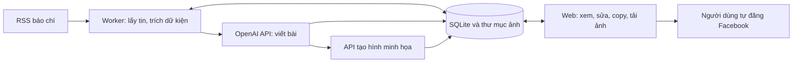

# FB_CT — Solution MVP

Cập nhật: 13/10/2026. Đây là thiết kế ban đầu. Theo yêu cầu chạy local bằng `npm run dev`, bản triển khai dùng React/Vite + Express + SQLite; worker chạy trong process API. Xem [README.md](README.md) cho hành vi đã có và các giới hạn của bản local. Các mục như xác thực tài khoản và trần tiền bên dưới là hướng thiết kế cho giai đoạn tiếp theo.

## 1. Đầu ra người dùng nhận được

Mỗi tin đủ điều kiện tạo một bản nháp gồm nội dung Facebook tiếng Việt, đường dẫn nguồn và một ảnh minh họa. Người dùng mở web, kiểm tra, sửa, bấm **Copy nội dung**, bấm **Tải ảnh**, rồi tự đăng lên Facebook cá nhân.

Ví dụ cấu trúc bài: câu mở đầu → thông tin chính có nguồn → nhận xét hoặc câu hỏi cân nhắc → câu hỏi thảo luận nếu phù hợp → tên báo và link. Mặc định 150–250 từ, không kéo dài khi nguồn chỉ có vài dữ kiện. Văn bản copy là plain text có xuống dòng, không chứa cú pháp Markdown.

## 2. Kiến trúc nhỏ nhất phù hợp

| Thành phần | Chọn cho MVP | Mục đích |
| --- | --- | --- |
| Backend | FastAPI | Giao diện web và endpoint nghiệp vụ trong một ứng dụng |
| Giao diện | Jinja2 + HTMX, CSS đơn giản | Hiển thị danh sách, chỉnh sửa và cập nhật tiến độ |
| Thu thập tin | HTTP client + RSS parser + adapter từng báo | Tách logic lấy nguồn khỏi logic viết bài |
| Dữ liệu | SQLite bật WAL | Lưu tin, bản nháp, trạng thái job và sử dụng AI |
| Tác vụ nền | Một worker riêng, hàng đợi nằm trong SQLite | Gọi AI không giữ người dùng chờ trong request web |
| Nội dung | OpenAI Responses API + Structured Outputs | Nhận dữ kiện và bài nháp theo cấu trúc xác định |
| Ảnh | OpenAI Image API; thêm nhãn bằng bộ dựng ảnh | Tạo một ảnh và kiểm soát chữ tiếng Việt |
| Lưu ảnh | Thư mục trên persistent volume | Có thể tải lại ảnh sau khi restart |
| Triển khai | Một máy chủ, hai process web/worker | Dễ chạy, backup và theo dõi |

Đây là lựa chọn thiết kế cho một người dùng và lưu lượng nhỏ. FastAPI hỗ trợ render template qua Jinja2; xem [tài liệu chính thức](https://fastapi.tiangolo.com/advanced/templates/). SQLite WAL cho phép đọc trong khi ghi nhưng vẫn chỉ có một writer tại một thời điểm; mọi transaction cần ngắn, xem [SQLite WAL](https://www.sqlite.org/wal.html).

Worker kiêm lịch quét RSS nên không cần thêm scheduler riêng. Chưa có nhu cầu vận hành Redis, Celery, vector database hay nhiều dịch vụ. Nếu dự án có sẵn code TypeScript thì Next.js cũng phù hợp; với thư mục đang trống, Python thuận tiện cho pipeline đọc tin và xử lý hình.

## 3. Pipeline xử lý

### A. Lấy tin và chọn tin

- Nguồn đầu tiên: [RSS BĐS VnExpress](https://vnexpress.net/rss/bat-dong-san.rss), có trong [danh mục RSS chính thức](https://vnexpress.net/rss).
- Quét mỗi 15 phút; có nút “Lấy tin ngay”. Dùng ETag/Last-Modified nếu nguồn hỗ trợ; đặt timeout và giới hạn kích thước tải.
- Lưu tên báo, GUID nếu có, URL chuẩn hóa, tiêu đề, tóm tắt, thời điểm đăng và thời điểm lấy. Thiếu ngày đăng phải được đánh dấu, không tự đoán.
- Chống trùng bằng URL/GUID; hash nội dung nhận diện phiên bản. Tin gần giống từ nhiều báo được gợi ý cùng nhóm, không tự xóa tin cập nhật.
- Lọc theo thị trường, chính sách, quy hoạch và nhà ở; các chủ đề không phù hợp được lưu nhưng không tự sinh bài.
- Lần đầu chỉ tự xử lý tin trong 48 giờ. Mỗi ngày tối đa 3 bài mới; phần vượt hạn mức chờ, rồi được kiểm tra độ mới trước khi chạy tiếp.

### B. Lấy phần nguồn dùng để viết

MVP bắt đầu từ dữ liệu RSS. Nếu cần bài dài hơn, adapter chỉ lấy nội dung trang khi điều kiện truy cập và sử dụng cho phép; không vượt paywall hoặc cơ chế chặn truy cập. Có thể bổ sung nội dung do người dùng cung cấp có quyền sử dụng.

Mỗi nguồn có chế độ đọc rõ ràng: `rss_only`, `article_allowed` hoặc `manual`. Việc có RSS không mặc nhiên cho phép sao chép toàn bài hay hình ảnh. Hệ thống không cần xây kho lưu nguyên văn toàn bộ báo; lưu metadata, hash và phần bằng chứng tối thiểu cần cho đối chiếu.

Nếu chỉ có tiêu đề hoặc thông tin chưa đủ để viết chính xác, chuyển “Thiếu nội dung nguồn”. Nếu tóm tắt đủ cho một tin ngắn, tạo bản nháp ngắn với nhãn “Dựa trên RSS tóm tắt”. Không dùng kiến thức nền của model để lấp dữ kiện còn thiếu.

### C. Trích dữ kiện rồi viết bài

Thực hiện hai bước logic, lưu kết quả mỗi bước để có thể tiếp tục khi lỗi:

1. Trích các dữ kiện có bằng chứng: sự kiện, địa phương, tên dự án, số liệu, đơn vị, thời gian, chủ thể phát biểu và những điểm chưa biết.
2. Viết bài từ bộ dữ kiện đã trích; mỗi khẳng định chính gắn với ID dữ kiện. Nhận xét phải có cách diễn đạt thể hiện suy luận, không biến thành thông tin được báo xác nhận.

Gọi Responses API với schema xác định. [OpenAI Docs về Structured Outputs](https://developers.openai.com/api/docs/guides/structured-outputs?api-mode=responses) mô tả cơ chế trả kết quả theo JSON Schema. Schema giúp kiểm soát định dạng; kiểm tra nội dung vẫn cần thực hiện riêng. Xử lý cả trường hợp API từ chối hoặc trả lời chưa hoàn tất.

Các trường kết quả tối thiểu:

| Nhóm | Dữ liệu |
| --- | --- |
| Nguồn | `source_id`, `source_version`, `content_basis` |
| Dữ kiện | `facts[]`: ID, nội dung, số liệu/đơn vị, bằng chứng nguồn |
| Bài nháp | `hook`, `body`, `closing_question`, `hashtags` |
| Đối chiếu | `claim_fact_ids`, `missing_information`, `review_flags` |
| Ảnh | `image_brief`, `image_caption` |

Backend tự thêm tên báo và URL từ dữ liệu đã lưu, không lấy URL do model tự sinh. Kiểm tra bằng mã các ID nguồn, bằng chứng trích, số tiền, đơn vị, tỷ lệ và ngày tháng. Giá trị quy đổi phải có phép tính rõ ràng; giá trị không đối chiếu được đưa vào diện cần kiểm tra. Kiểm tra tự động không bảo đảm hiểu đúng mọi ngữ cảnh, vì vậy người dùng luôn xem bài trước khi đăng.

Nội dung báo được xem là dữ liệu đầu vào: loại HTML/script, không làm theo chỉ dẫn nằm trong bài, không cấp công cụ xuất bản hay truy cập tùy ý cho model.

### D. Tạo hình

- Khi bài hoàn tất và không còn lỗi dữ kiện đã phát hiện, tự tạo một ảnh minh họa trong hạn mức.
- Dùng cảnh đô thị, căn hộ hoặc đồ họa trung tính; không dựng dự án cụ thể như ảnh chụp thực tế, bản đồ quy hoạch hoặc giấy tờ pháp lý.
- Prompt xuất phát từ chủ đề và dữ kiện được phép dùng, tránh tự thêm logo, giá bán hoặc chi tiết dự án.
- Tạo nền bằng API; thêm tiêu đề ngắn và nhãn “Ảnh minh họa AI” bằng bộ dựng ảnh có font tiếng Việt. Đầu ra mặc định là ảnh vuông; kích thước API chọn theo model rồi xuất file cuối.
- [OpenAI Docs về Image API](https://developers.openai.com/api/docs/guides/image-generation) hỗ trợ tạo ảnh từ prompt và phù hợp với trường hợp một ảnh độc lập.
- Nếu tạo ảnh lỗi, bài vẫn có thể xem và copy. Cho thử lại trong hạn mức hoặc tải cover đồ họa dựng từ template với nhãn “Hình minh họa”.

### E. Duyệt và sử dụng

Trang chi tiết đặt nguồn, nội dung đã viết và hình gần nhau để dễ soát. Người dùng sửa và lưu trước khi copy. Tạo lại bằng AI sinh phiên bản mới, không ghi đè bản người dùng đã sửa. Khi nguồn hoặc nội dung thay đổi, đánh dấu ảnh/bài cần kiểm tra lại thay vì âm thầm cập nhật.

Copy phải bao gồm đúng nội dung đã lưu và dòng nguồn. Trạng thái “Đã copy” chỉ ghi nhận thao tác; “Đã đăng” là nút đánh dấu thủ công.

## 4. Giao diện MVP

| Màn hình | Chức năng |
| --- | --- |
| Tin mới | Tiêu đề, nguồn, ngày, nhóm chủ đề; lọc tin; lấy tin ngay |
| Bài nháp | Xem nguồn, dữ kiện, nội dung, ảnh; sửa/lưu; tạo lại; copy; tải hình |
| Lịch sử | Bài đã bỏ qua, đã copy, tự đánh dấu đã đăng; xem phiên bản |
| Cài đặt | Nguồn, khu vực ưu tiên, giọng văn, lịch lấy tin, hạn mức bài/ảnh/chi phí |

Trạng thái sản phẩm dùng tiếng Việt: Tin mới, Đang xử lý, Thiếu nguồn, Chờ kiểm tra, Chờ hạn mức, Bản nháp sẵn sàng, Lỗi cần xử lý. Trạng thái ảnh độc lập để lỗi ảnh không che mất bài đã hoàn tất. Chi tiết model/token nằm ở cài đặt hoặc lịch sử sử dụng.

## 5. Dữ liệu và tác vụ nền

| Bảng | Vai trò |
| --- | --- |
| `sources` | Feed, domain cho phép, chế độ đọc, lịch quét, trạng thái nguồn |
| `articles` | Metadata RSS, URL/GUID, hash và phiên bản nguồn, dữ kiện/bằng chứng |
| `drafts` | Liên kết nguồn/phiên bản, bản AI, bản người dùng sửa, trạng thái duyệt/copy/đã đăng |
| `assets` | File ảnh, prompt, loại minh họa, phiên bản bài, trạng thái |
| `jobs` | Loại việc, khóa chống trùng, trạng thái, số lần thử, thời điểm chạy lại, lease |
| `usage_events` | Model, token/ảnh, mã request nếu có, chi phí ước tính, kết quả |

Ba loại job chính: `fetch_feed`, `build_draft`, `generate_image`. Job được lưu DB trước khi chạy. Worker nhận job bằng transaction nguyên tử và gia hạn lease; job bị bỏ dở được xem xét lại sau khi lease hết hạn. Không giữ transaction khi chờ mạng hoặc AI.

Khóa chống trùng theo từng loại job:

- `fetch_feed`: nguồn và khung thời gian quét; nút lấy ngay vẫn được chống chạy đồng thời với lần quét đang xử lý.
- `build_draft`: bài nguồn, phiên bản nguồn, phiên bản prompt và revision yêu cầu tạo lại.
- `generate_image`: ID bài nháp, revision bài nháp, hash image brief, phiên bản prompt ảnh và revision yêu cầu tạo lại ảnh. Người dùng sửa bài rồi tạo lại ảnh phải tạo được ảnh gắn với bản sửa đó.

Lỗi tạm thời được thử lại có giới hạn và giãn cách; lỗi dữ liệu, quyền truy cập hoặc API key cần báo rõ để xử lý.

SQLite chặn công việc trùng trong ứng dụng, nhưng không bảo đảm một request AI chỉ bị tính phí đúng một lần nếu mất kết nối sau khi nhà cung cấp đã xử lý. Với timeout không rõ kết quả, ghi trạng thái chờ đối soát, tận dụng mã request/cơ chế nhà cung cấp nếu có; không tự sinh ảnh lại liên tục.

## 6. Vận hành và chi phí

- Chạy thử cục bộ; bản dùng thường xuyên đặt trên máy chủ có ổ đĩa bền vững. Máy cá nhân chỉ quét được khi ứng dụng đang chạy.
- Web và worker dùng một image ứng dụng, hai process trên cùng máy. SQLite WAL đặt trên filesystem cục bộ, không dùng network filesystem.
- API key nằm ở backend trong biến môi trường. Đăng nhập một tài khoản; khi đưa lên Internet có HTTPS, cookie phiên phù hợp và bảo vệ thao tác ghi.
- URL lấy nguồn theo allowlist; kiểm tra redirect và chặn địa chỉ nội bộ. Giới hạn kích thước nội dung và thời gian tải.
- Backup SQLite bằng cơ chế backup nhất quán cùng thư mục ảnh; kiểm tra phục hồi trước khi đưa vào dùng.
- Theo dõi lần quét cuối, worker heartbeat, hàng đợi và lỗi API; người dùng thấy nguồn ngừng cập nhật thay vì tưởng rằng không có tin mới.

Model văn bản và hình cấu hình riêng qua `TEXT_MODEL` và `IMAGE_MODEL`. Chọn bằng thử nghiệm một tập tin mẫu tiếng Việt trên tài khoản API sẽ sử dụng; không gắn cứng model hoặc đơn giá vào thiết kế.

Chi phí tháng = hosting + lưu trữ/backup + tổng token vào × đơn giá vào + tổng token ra × đơn giá ra + tổng chi phí tạo ảnh. Đơn giá token phải quy về cùng đơn vị, ví dụ mỗi một triệu token. Ảnh tính theo bảng giá model/chất lượng/kích thước, hoặc usage token nếu nhà cung cấp áp dụng.

Với 3 bài/ngày, 30 ngày là trần 90 bài mới và tối đa 90 ảnh đầu tiên. Regenerate và retry có hạn mức riêng, cùng tính vào trần tiền. Trước mỗi lệnh AI, dự trù và giữ chỗ ngân sách; hết ngân sách thì chuyển chờ hạn mức. Usage trong app là ước tính, không thay hóa đơn nhà cung cấp.

## 7. Danh sách công việc triển khai

1. **Nền tảng:** cấu trúc ứng dụng, SQLite/migration, đăng nhập, cấu hình và lưu file; dựng danh sách tin/bài.
2. **Nguồn tin:** parser RSS VnExpress, kiểm thử feed thực tế, chuẩn hóa URL, chống trùng, lọc chủ đề và giới hạn lần nạp đầu.
3. **Nội dung:** adapter nguồn, trích dữ kiện, prompt/schema, kiểm tra, lưu phiên bản và xử lý thiếu nguồn.
4. **Hình và sử dụng:** tích hợp tạo ảnh, cover template, sửa/lưu, copy nguồn, tải hình, lịch sử.
5. **Đưa vào dùng:** worker/lịch bền vững, retry/hạn mức, xử lý timeout chưa rõ kết quả, deploy, backup và kiểm thử phục hồi.

Sau khi MVP ổn định mới bổ sung adapter báo khác, mẫu giọng văn từ bài người dùng cung cấp, và bài tổng hợp nhiều nguồn. Mỗi nguồn mới cần kiểm tra riêng feed, cấu trúc nội dung và điều kiện sử dụng.

## 8. Tiêu chí nghiệm thu

- RSS thật đọc được; nguồn lỗi không làm ngừng xử lý bài đã lưu.
- Quét lại hoặc bấm nhiều lần không tạo trùng bản nháp cho cùng phiên bản nguồn.
- Tin quá cũ, thiếu nội dung hoặc vượt hạn mức không tự sinh bài/ảnh hàng loạt.
- Các trường hợp mẫu về giá, phần trăm, thời gian, địa phương, quy hoạch và thông tin pháp lý giữ đúng phạm vi nguồn; phần không chắc chắn bị gắn cờ.
- Mỗi bài truy được nguồn, dữ kiện sử dụng và thời điểm lấy; bản sửa thủ công được bảo toàn khi nguồn thay đổi.
- Copy trả đúng nội dung đã sửa, xuống dòng và đường dẫn nguồn; ảnh tải về mở được, có nhãn minh họa.
- Restart ở giữa pipeline không làm mất job; timeout sinh ảnh không dẫn đến retry tính phí không kiểm soát.
- Lỗi ảnh vẫn cho xem/copy bài; thao tác copy không tự đánh dấu đã đăng.
- Hạn mức áp dụng cả với tạo lại và thử lại; API key không xuất hiện ở frontend/log.
- Backup phục hồi được cả dữ liệu và ảnh.

## 9. Căn cứ nguồn và giới hạn đã biết

[RSS VnExpress](https://vnexpress.net/rss) xác nhận kênh BĐS và bản chất thông tin RSS. [Điều khoản sử dụng](https://vnexpress.net/dieu-khoan-su-dung) đặt giới hạn tái sử dụng nội dung/hình cho mục đích thương mại; thiết kế phải xác định quyền dùng nguồn theo mục đích thực tế, không coi ghi nguồn là đủ.

Đã đối chiếu danh mục RSS và tài liệu chính thức API/framework. Bản local đã đọc được 60 tin từ RSS trực tiếp và có kiểm thử nghiệp vụ với fixture/mock. Chất lượng bài, độ trễ sinh ảnh và chi phí thực tế với key của người dùng cần đo khi cấu hình API. Xem README cho hướng dẫn chạy và phạm vi đã triển khai.
